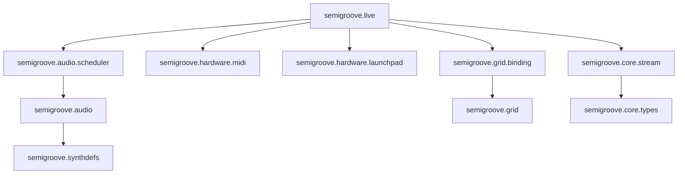

# Architecture

Reference doc for Semigroove's design. Ported from Funktor's `docs/architecture.md` with Clojure/Overtone idioms substituted. Read this before any structural change.

Synthesis runs in `scsynth`. Clojure owns the pattern DSL, scheduler, REPL session, MIDI input, and Launchpad grid. Sample-level DSP is `scsynth`'s job.

## Namespace Layers

Each layer depends only on what's below it. Every layer below is implemented; features marked *(planned)* are designed but not yet built (the grid's instrument/scene modes, M15/M16).



An arrow points from a namespace to the namespace it depends on.

- `semigroove.live`: REPL interface (play / stop / set-tempo / start-midi).
  start-launchpad lives in `semigroove.grid.binding`, which requires `semigroove.live`.
- `semigroove.audio.scheduler`: wall-clock event scheduler plus hot-swap.
- `semigroove.audio`: facade (open! / note-on / note-off / release-all) wrapping Overtone.
- `semigroove.synthdefs`: the `semigroove-note` defsynth in `src/semigroove/synthdefs.clj`.
- `semigroove.hardware.midi`: MIDI input to a core.async chan to a scheduler swap!.
- `semigroove.hardware.launchpad`: Mk3 SysEx; midi-to-pad translation (pure).
- `semigroove.grid.binding`: sequencer-mode pad binding (`:instrument` / `:scene` modes planned, M15/M16).
- `semigroove.grid`: pad / color / pad-action, pure data.
- `semigroove.core.stream`: arc to [event] (periodic / cat / stack / slow / fast / shift).
- `semigroove.core.types`: beat (ratio), arc, event.

## Runtime Model

A `(play stream)` call boots one scheduler thread that talks to scsynth via Overtone's OSC layer.

    REPL                       Scheduler thread          scsynth (OS process)
    ─────────────────────────────────────────────────────────────────────────
    (play stream)
      ├─ ensure scsynth via Overtone ────UDP socket────> 127.0.0.1:57110
      ├─ initial scheduler state                             │
      └─ (future ...) ────> scheduler loop                   │
                                │                            │
                                │  every ~10ms, sending      │
                                │  ahead by latency L:       │
                                │   1. now=(System/nanoTime) │
                                │   2. query stream window   │
                                │      [cursor .. now+L+tick)│
                                │   3. beats→secs at L offset│
                                │   4. emit timestamped ─────┼── (at t)  /s_new freq amp
                                │      OSC bundles ──────────┼── (at t') /n_set id gate 0
                                │   5. advance cursor; park  │   /n_free id (steal)
                                ▼                            ▼  scsynth fires each bundle
                            atom scheduler-state         at its own timestamp; JVM
                            (cursor, pending releases)   jitter within L is absorbed

The scheduler **sends ahead**, not just-in-time. Each tick queries a window that reaches `L` (~100 ms) into the future, converts beats to seconds, and ships timestamped OSC bundles (`bundle-at`); `scsynth` plays each at its own timestamp. A just-in-time `/s_new` on each due event would instead re-expose every onset to JVM scheduling jitter — the bundle-ahead model is what makes timing audible-tight. `L` trades latency for jitter immunity: large enough to cover a GC pause and a few ticks, small enough that live MIDI/grid input still feels responsive.

State coordination uses **atoms**, not Haskell TVars. STM-grade transactions weren't load-bearing in Funktor — single-writer atoms with `swap!` are simpler and equally correct here.

- **`scheduler-state` (atom)** — current stream, tempo, transport beat, pending events. Written by `play` / `set-tempo` (hot-swap), grid commits, MIDI router, and the scheduler loop.
- **`live-state` (atom in `semigroove.live`)** — session handle. Survives REPL evaluations natively; no `foreign-store` equivalent needed.

`semigroove.audio` owns its own per-session state (active-voice map by pitch). Overtone gives us node objects directly; we may not even need a manual Pitch→NodeId map (TBD during implementation).

### Process lifecycle

`semigroove.audio/open!` registers a JVM shutdown hook on first call:

``` clojure
(.addShutdownHook (Runtime/getRuntime)
  (Thread. ^Runnable (fn [] (kill-server))))
```

The hook is guarded by a `compare-and-set!` on `hook-registered` so it fires at most once per JVM. Without it, a JVM crash leaves an orphaned scsynth holding port 57110; the next boot fails with "address in use". `pkill scsynth` is the manual recovery.

The hook lives in `semigroove.audio` (registered at `open!`) rather than `semigroove.live` — the audio facade is the correct owner since it's what talks to the server.

## Key Design Decisions

### Native ratios for beats

Clojure has `clojure.lang.Ratio` built-in. Triplets are literally `1/3` in source code:

``` clojure
(def triplet-eighth 1/12)   ;; reads as a Ratio, not a Double
```

Convert to seconds only at the audio boundary (scheduler → OSC `bundle-at`).

### Stream as an arc-indexed query function

``` clojure
;; stream is just a function: arc -> seq of events

(defn- ceil-beats
  "Smallest integer >= r, in exact arithmetic — never coerces to double.
   (Math/ceil would return a Double and silently break the Ratio invariant.)"
  [r]
  (let [t (long r)]                       ; truncates toward zero
    (if (and (ratio? r) (pos? r)) (inc t) t)))

(defn periodic [period value]
  (fn [{:keys [start end]}]
    ;; first onset = smallest multiple of `period` that is >= start
    (let [first-onset (* period (ceil-beats (/ start period)))]
      (for [n (range first-onset end period)]  ; range stays exact with Ratio args
        {:whole {:start n :end (+ n period)}
         :part  {:start n :end (+ n period)}
         :value value}))))
```

Not a lazy seq. The scheduler asks "events whose `:part :start` falls in this arc" each tick and gets back exactly those. No materialization of unused future events.

Smart constructors `periodic`, `cat`, `stack`, `slow`, `fast` mirror funktor's `Funktor.Core.Stream`. Port them; the algebra is the gem and it's language-independent.

### Synthesis lives in scsynth

Voice pool, oscillators, envelopes, filters all run inside `scsynth`. Overtone's `definst` / `defsynth` compiles Clojure → SuperCollider bytecode and ships it to the server. Semigroove sends `(synth :freq f :amp a)` to spawn and `(ctl node :gate 0)` to release; `EnvGen :action FREE` runs the release tail and frees the node.

We do *not* maintain Haskell-style `Funktor.Audio.Timbre` records — Overtone synth defs are first-class values, so a "timbre" is just a synth + a map of param overrides.

### Out-of-band MIDI routing

MIDI input goes onto a `core.async` channel. A router thread takes from the channel and uses `swap!` on `scheduler-state` to enqueue immediate events. The scheduler tick never blocks on MIDI.

Equivalent to Funktor's `PortMidi → TQueue → enqueueImmediate` pattern, but with `core.async/chan` instead of `STM TQueue`.

### Monotonic clock

`(System/nanoTime)` for scheduling. Immune to wall-clock jumps (NTP, DST).

### No reload machinery

This is the big one. Funktor needed `foreign-store` + `fsnotify` to survive GHCi `:reload`. **Clojure's REPL IS the live image** — redefining a `defn` rebinds its var in place while the scheduler thread keeps running. No persistence layer needed.

**One hot-swap mechanism, though — and it goes through the atom, not the var.** The scheduler reads the current stream from `scheduler-state` every tick; it does *not* close over a stream var. To change what's playing you build the new stream and `swap!` it into `scheduler-state` — that's all `play`, `set-tempo`, grid commits, and the MIDI router do. So "re-eval the stream and hear it" is really "re-eval, then re-`play` (or commit) to swap the new value in." Closing over a stream var's *value* at `play`-time would make redefinition a silent no-op; reading from the atom is the model that also makes grid commits and MIDI routing uniform (they all just `swap!`).

Since M12 shipped (#10), `live/play` is not a hot-swap: it resets the session to a single `:main` track, moves the transport to beat 0, and releases every voice.
Swapping one stream without a restart goes through `live/add-track`, which replaces a named track's stream and leaves the transport alone; the M15 sequencer and M16 scenes use it.
Each scheduler tick queries from its cursor up to the wall-clock beat plus the lookahead (`lookahead-nanos`, 100 ms) and no further, so a track added mid-session is heard within about one lookahead.

The entire `Funktor.Live.Reload` namespace simply does not have a Semigroove equivalent.

## Constraints

- Macros are welcome, and encouraged where they sharpen the live-coding surface. This is a Lisp; reach for a macro when it makes the change-make-hear loop terser or safer. (Funktor's "boring Haskell" constraint was Haskell's; it does not carry over here.)
- One REPL session per work session — design assumes a long-running JVM. Don't add features that require restarting the JVM.
- Pure data flows downward; side effects only in `semigroove.audio` and `semigroove.hardware.*`.
- Every namespace gets a `test/semigroove/.../X_test.clj` spec. `clojure.test` is enough — no need for kaocha/midje unless it earns its keep.
